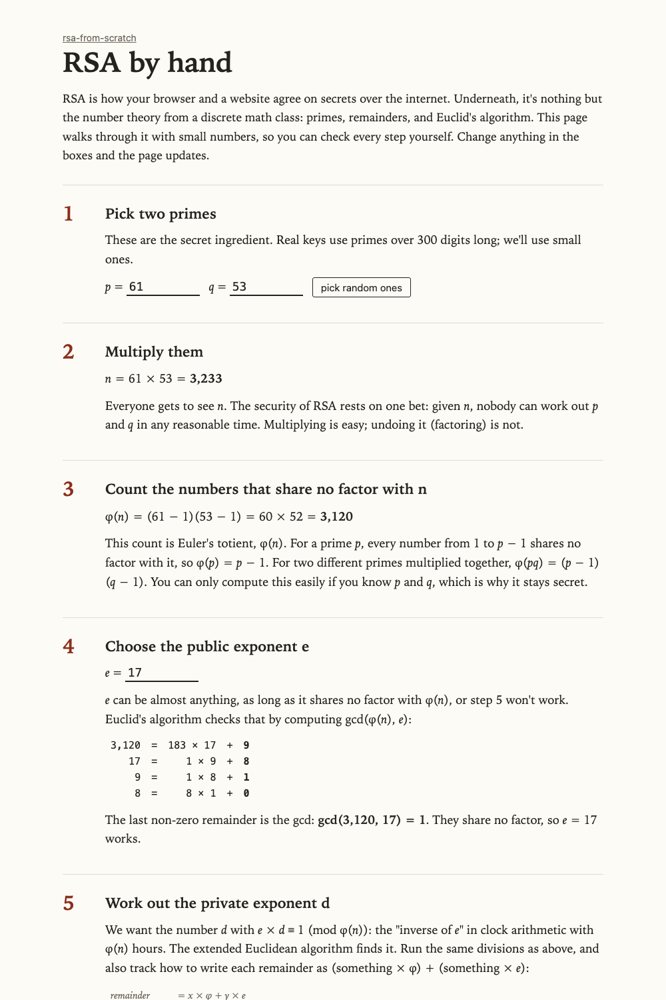

# rsa-from-scratch

RSA encryption built from the ground up, using nothing but the number theory from an
intro discrete math course.

**[Try it in your browser: RSA by hand →](https://mamoonrkhan.github.io/rsa-from-scratch/)**

[](https://mamoonrkhan.github.io/rsa-from-scratch/)

## Why I made this

In discrete math, topics like modular arithmetic, Euclid's algorithm and Euler's theorem
can feel like puzzles for their own sake. RSA is the clearest example I know of where
they turn out to matter: every time you load a website over HTTPS, your browser relies
on exactly these facts. So I implemented the whole thing myself, without using any
crypto libraries, to see each piece of the math doing its job.

## How RSA works, in one paragraph

Pick two big primes *p* and *q* and multiply them to get *n*. Publish *n* along with a
number *e*. Anyone can encrypt a message *m* by computing *m^e mod n*. To decrypt, you
need a matching number *d*, and working out *d* requires knowing *p* and *q*. Getting
*p* and *q* back from *n* means factoring it, and for a 600-digit *n* nobody knows how
to do that in any reasonable amount of time. So the person who picked the primes can
decrypt, and nobody else can.

## The discrete math, and where it shows up

| Topic from class | What it's used for in RSA | Code |
|---|---|---|
| Modular arithmetic | All of RSA is arithmetic "mod n", like a clock with n hours | everywhere |
| GCD and Euclid's algorithm | Checking that *e* is a valid choice: gcd(*e*, φ(*n*)) must be 1 | `gcd` in [numbers.py](toyrsa/numbers.py) |
| Bézout's identity, extended Euclid | Computing the private key *d*, the inverse of *e* mod φ(*n*) | `extended_gcd`, `mod_inverse` |
| Binary representation | Computing *m^e mod n* in about 2,000 steps instead of 2^2048 | `mod_pow` (square-and-multiply) |
| Primes, Fermat's little theorem | Testing whether a 300-digit number is prime, without factoring it | `is_probable_prime` (Miller-Rabin) |
| Prime number theorem | Why random guessing finds big primes quickly (about 1 in 710 numbers near 2^1024 is prime) | `random_prime` |
| Euler's totient and Euler's theorem | The proof that decrypting gives you back the original message | `make_keypair`, and the walkthrough |
| Chinese Remainder Theorem | Decrypting about 3× faster; also one of the attacks | `decrypt_int_crt` in [rsa.py](toyrsa/rsa.py) |
| Growth of functions | Why factoring is hopeless at real key sizes | [attacks.py](toyrsa/attacks.py) |

## Running it

Just Python 3.9 or newer. There are no dependencies.

```sh
python3 examples/walkthrough.py   # the textbook example (p = 61, q = 53), every step printed
python3 examples/attacks.py       # breaking RSA when it's used badly
python3 examples/crt_speedup.py   # how much the Chinese Remainder Theorem helps
python3 -m unittest discover tests
```

Or use it from Python:

```python
from toyrsa import generate_keypair, encrypt_text, decrypt_text, sign, verify

public, private = generate_keypair(2048)
c = encrypt_text("meet at noon", public)
decrypt_text(c, private)                         # 'meet at noon'

s = sign("I owe you $5", private)
verify("I owe you $5", s, public)                # True
verify("I owe you $500", s, public)              # False
```

## Things I found

**Factoring really is hopeless.** Trial division (try dividing by 3, 5, 7, ... up to
√n) gets about 4 times slower for every 4 bits added to the key:

| key size | time to factor |
|---:|---:|
| 32 bits | 0.001 s |
| 40 bits | 0.02 s |
| 48 bits | 0.29 s |
| 52 bits | 1.3 s |

A real key is 2048 bits. At that rate it would need about 2^1024 (roughly 10^308)
divisions. There are smarter factoring algorithms, but none come close to fast enough.

**The Chinese Remainder Theorem makes decryption about 3× faster.** Instead of one big
calculation mod *n*, you do two half-size ones mod *p* and mod *q* and combine them.
That's why real RSA implementations store *p* and *q* in the private key.

| key size | normal | with CRT |
|---:|---:|---:|
| 1024 bits | 7.2 ms | 2.9 ms |
| 2048 bits | 49.6 ms | 18.9 ms |

**"Textbook" RSA breaks in surprising ways.** [examples/attacks.py](examples/attacks.py)
shows four:

1. **Small keys**: factor *n* and rebuild the private key.
2. **Two keys sharing a prime**: gcd(*n1*, *n2*) gives the shared prime in microseconds,
   breaking both keys. In 2012, researchers did this to tens of thousands of real keys
   on the internet, which had been generated with bad random numbers.
3. **A small *e* with a short message**: if *m^3 < n*, then *c* is just *m^3*, and a
   cube root gets the message back.
4. **The same message sent to three people**: the Chinese Remainder Theorem combines
   the three ciphertexts so that attack 3 works again.

The page also shows a fifth problem: encrypting letter by letter means the same letter
always gives the same ciphertext. Real RSA prevents all of these by adding random
padding to every message before encrypting.

## How I tested it

Each hand-written function is checked against Python's built-in version (`math.gcd`,
`pow`) on thousands of random inputs. The primality test is checked against a sieve for
every number up to 20,000, plus Carmichael numbers, which fool simpler tests. RSA itself
is tested by encrypting and decrypting every possible message for a small key, and
random messages for 512 to 2048-bit keys.

## Please don't use this for real security

This is textbook RSA for learning. It has no padding and isn't protected against timing
attacks. For anything real, use a vetted library like
[`cryptography`](https://cryptography.io/).

MIT license.
